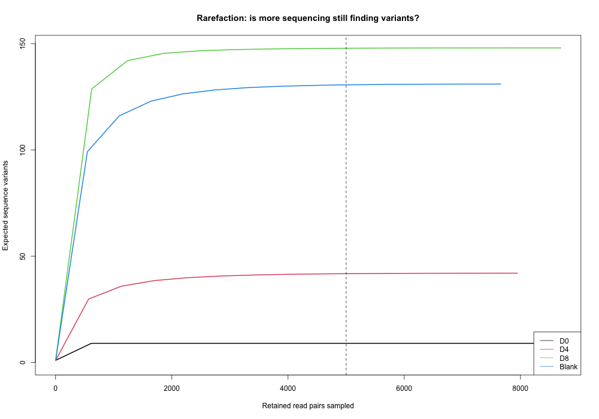
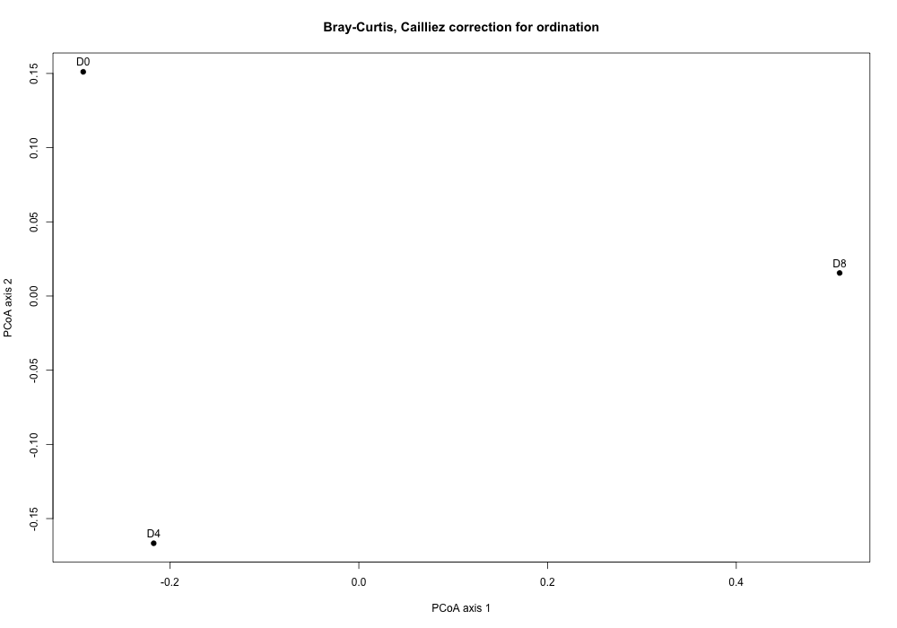
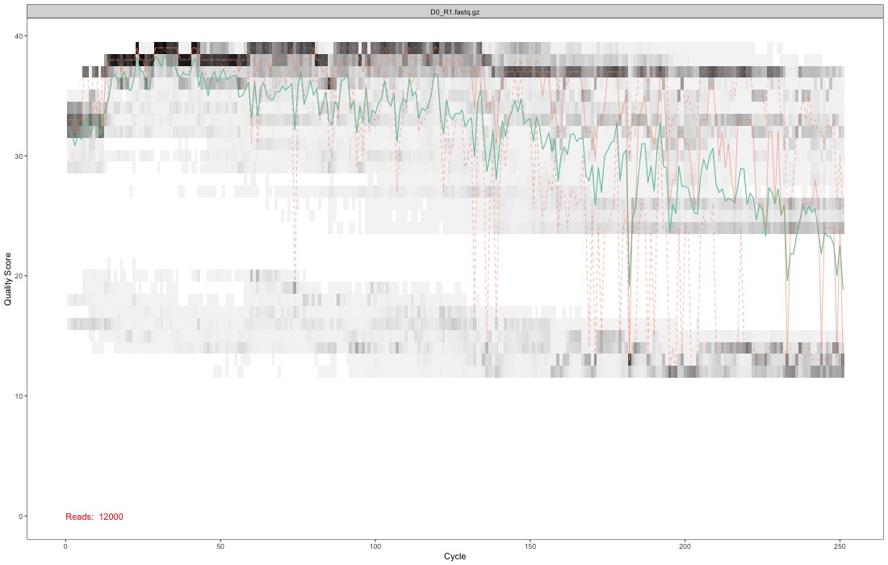
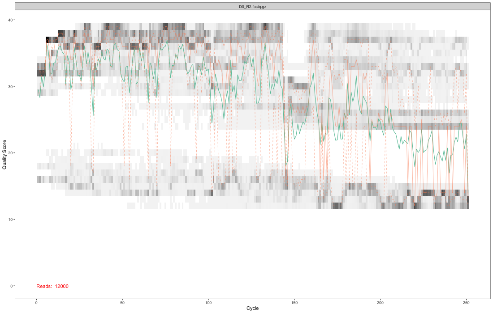
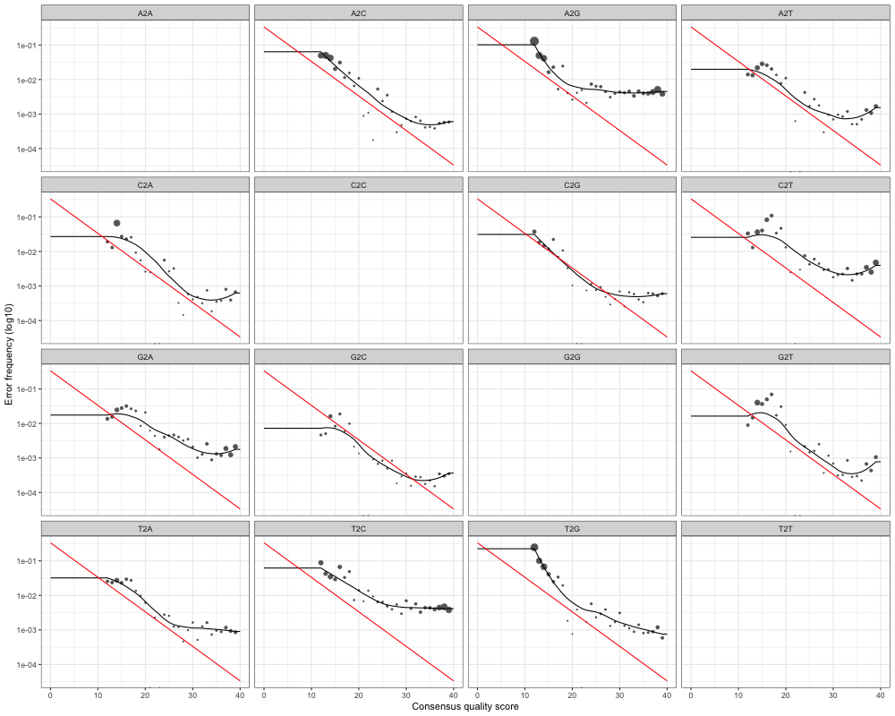
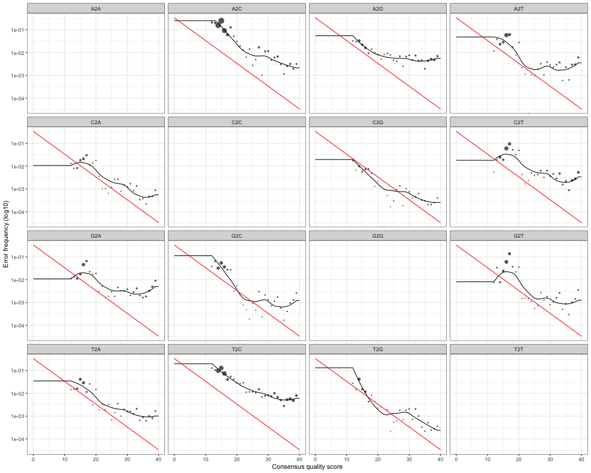

# Public SRA demonstration

This report follows public bacterial marker-gene reads from quality checks through sequence inference, organism names and diversity. The samples are a mock-community dilution series, not independent environmental communities. Differences are descriptive; no population or health conclusions follow.

## Run summary

| samples | raw_pairs | nonchimeric_pairs | asvs | eligible_samples | too_shallow_samples | flagged_asvs | depth |
| --- | --- | --- | --- | --- | --- | --- | --- |
| 4 | 48000 | 32907 | 266 | 3 | 0 | 25 | 5000 |

ASVs are distinct DNA sequence variants inferred after modelling sequencing errors. Counts are read pairs, not numbers of cells. The depth is a user-selected comparison threshold, not a universal quality standard.

## Read survival

| sample | type | run | raw_pairs | filtered_pairs | denoised_forward | denoised_reverse | merged | nonchimeric |
| --- | --- | --- | --- | --- | --- | --- | --- | --- |
| D0 | sample | SRR7588938 | 12000 | 9374 | 9249 | 9273 | 8859 | 8607 |
| D4 | sample | SRR7588942 | 12000 | 8806 | 8615 | 8645 | 7948 | 7948 |
| D8 | sample | SRR7588945 | 12000 | 10084 | 10016 | 9894 | 8794 | 8692 |
| Blank | negative | SRR10898399 | 12000 | 10129 | 9673 | 9737 | 7732 | 7660 |

Raw reads were already separated by sample in the archive. The pipeline trims the first bases and low-quality tails, filters expected errors, learns separate forward/reverse error models with DADA2, infers variants, merges overlapping pairs and removes consensus chimeras (artificial mixed sequences).

## Which samples can be compared?

| sample | retained | eligible | status | tail_gain_fraction | rarefaction_warning |
| --- | --- | --- | --- | --- | --- |
| D0 | 8607 | TRUE | ELIGIBLE at requested depth | 0 | small final gain; not proof of complete coverage |
| D4 | 7948 | TRUE | ELIGIBLE at requested depth | 0.000262681736101132 | small final gain; not proof of complete coverage |
| D8 | 8692 | TRUE | ELIGIBLE at requested depth | 8.109108372225e-06 | small final gain; not proof of complete coverage |
| Blank | 7660 | FALSE | CONTROL: excluded from diversity | 0.000169406797774914 | small final gain; not proof of complete coverage |

Controls are always excluded from diversity. Samples below the requested depth are explicitly excluded. The last-column warning checks the expected gain in variants over the final tenth of sequencing. A small gain does not guarantee complete coverage.

## Rarefaction

Rarefaction asks how many variants I would expect to see at a smaller read count. The dashed line marks the requested comparison depth.

## Diversity within each eligible sample

| sample | depth | observed_asvs | shannon | simpson |
| --- | --- | --- | --- | --- |
| D0 | 5000 | 9 | 1.85372298126115 | 0.81414968 |
| D4 | 5000 | 42 | 2.20506067832681 | 0.82779312 |
| D8 | 5000 | 148 | 4.51801005284268 | 0.98256128 |

Each eligible sample is randomly subsampled without replacement to the same depth with a fixed seed. Observed ASVs counts variants; Shannon diversity reflects richness and evenness; Simpson diversity is one minus the probability of drawing the same variant twice (using relative abundances). One subsample is a reproducible illustration and has sampling uncertainty.

## Diversity between eligible samples

| sample | D0 | D4 | D8 |
| --- | --- | --- | --- |
| D0 | 0 | 0.3264 | 0.813 |
| D4 | 0.3264 | 0 | 0.7494 |
| D8 | 0.813 | 0.7494 | 0 |

Bray-Curtis distance runs from identical composition (zero) to no shared variants (one). The plot is a principal-coordinate view of those distances with a Cailliez correction if needed. There are no replicate groups and no significance tests.

## Negative-control check

screened: heuristic only, no automatic removal

The extraction blank is a real archived negative control. The screen flags a variant when its mean relative abundance in nonempty blanks is at least one percent and at least five times its mean in nonempty biological samples. This is a review heuristic, not a validated contaminant classifier. With one blank, prevalence evidence is weak. Carryover, extraction contaminants and true shared organisms can look alike. Nothing is automatically deleted; diversity uses all non-chimeric variants. Empty or missing controls are reported as unavailable.

| asv | blank_mean | sample_mean | blank_prevalence | sample_prevalence | flag |
| --- | --- | --- | --- | --- | --- |
| ASV0030 | 0.0220626631853786 | 0.00276115968706857 | 1 | 0.333333333333333 | TRUE |
| ASV0031 | 0.0126631853785901 | 0.00092038656235619 | 1 | 0.333333333333333 | TRUE |
| ASV0048 | 0.116971279373368 | 0 | 1 | 0 | TRUE |
| ASV0063 | 0.0237597911227154 | 0 | 1 | 0 | TRUE |
| ASV0064 | 0.0178851174934726 | 0 | 1 | 0 | TRUE |
| ASV0076 | 0.0160574412532637 | 0 | 1 | 0 | TRUE |
| ASV0086 | 0.0148825065274151 | 0 | 1 | 0 | TRUE |
| ASV0088 | 0.0133159268929504 | 0 | 1 | 0 | TRUE |
| ASV0109 | 0.0180156657963446 | 0 | 1 | 0 | TRUE |
| ASV0112 | 0.0181462140992167 | 0 | 1 | 0 | TRUE |
| ASV0156 | 0.012402088772846 | 0 | 1 | 0 | TRUE |
| ASV0158 | 0.0227154046997389 | 0 | 1 | 0 | TRUE |
| ASV0160 | 0.0203655352480418 | 0.00306550408611644 | 1 | 0.666666666666667 | TRUE |
| ASV0162 | 0.0112271540469974 | 0.00172572480441786 | 1 | 0.333333333333333 | TRUE |
| ASV0169 | 0.018798955613577 | 0 | 1 | 0 | TRUE |
| ASV0172 | 0.0126631853785901 | 0.00197377060418723 | 1 | 0.666666666666667 | TRUE |
| ASV0173 | 0.0193211488250653 | 0 | 1 | 0 | TRUE |
| ASV0196 | 0.0118798955613577 | 0 | 1 | 0 | TRUE |
| ASV0221 | 0.0195822454308094 | 0.000536892161374444 | 1 | 0.333333333333333 | TRUE |
| ASV0223 | 0.0194516971279373 | 0.00295290688755944 | 1 | 0.333333333333333 | TRUE |
| ASV0224 | 0.0298955613577024 | 0.00115048320294524 | 1 | 0.333333333333333 | TRUE |
| ASV0227 | 0.018668407310705 | 0 | 1 | 0 | TRUE |
| ASV0234 | 0.0570496083550914 | 0.000958736002454364 | 1 | 0.333333333333333 | TRUE |
| ASV0252 | 0.0197127937336815 | 0 | 1 | 0 | TRUE |
| ASV0257 | 0.0154046997389034 | 0 | 1 | 0 | TRUE |

All variants, including unflagged ones, have control/sample prevalence and abundance recorded in `contamination.tsv`.

## Taxonomy

Organism names are assigned by the DADA2 naive Bayesian classifier using the named reference and a minimum bootstrap support threshold. Uncertain ranks remain NA. These are genus-level annotations, not proof of species identity. Bootstrap support for every rank is saved separately.

| asv | Kingdom | Phylum | Class | Order | Family | Genus |
| --- | --- | --- | --- | --- | --- | --- |
| ASV0001 | Bacteria | Proteobacteria | Gammaproteobacteria | Pasteurellales | Pasteurellaceae | Haemophilus |
| ASV0002 | Bacteria | Proteobacteria | Deltaproteobacteria | Desulfovibrionales | Desulfovibrionaceae | Bilophila |
| ASV0003 | Bacteria | Proteobacteria | Betaproteobacteria | Neisseriales | Neisseriaceae | Neisseria |
| ASV0004 | Bacteria | Proteobacteria | Gammaproteobacteria | Enterobacterales | Enterobacteriaceae | Klebsiella |
| ASV0005 | Bacteria | Proteobacteria | Gammaproteobacteria | Enterobacterales | Enterobacteriaceae | NA |
| ASV0006 | Bacteria | Proteobacteria | Gammaproteobacteria | Enterobacterales | Enterobacteriaceae | NA |
| ASV0007 | Bacteria | Proteobacteria | Gammaproteobacteria | Enterobacterales | Enterobacteriaceae | Escherichia/Shigella |
| ASV0008 | Bacteria | Proteobacteria | Gammaproteobacteria | Pseudomonadales | Moraxellaceae | NA |
| ASV0009 | Bacteria | Proteobacteria | Deltaproteobacteria | Desulfovibrionales | Desulfovibrionaceae | NA |
| ASV0010 | Bacteria | Proteobacteria | Gammaproteobacteria | Pseudomonadales | Pseudomonadaceae | Pseudomonas |
| ASV0011 | Bacteria | Proteobacteria | Betaproteobacteria | Burkholderiales | Comamonadaceae | NA |
| ASV0012 | Bacteria | Proteobacteria | Betaproteobacteria | Burkholderiales | Alcaligenaceae | Achromobacter |
| ASV0013 | Bacteria | Proteobacteria | Betaproteobacteria | Burkholderiales | Sutterellaceae | Parasutterella |
| ASV0014 | Bacteria | Proteobacteria | Gammaproteobacteria | Pseudomonadales | Moraxellaceae | Acinetobacter |
| ASV0015 | Bacteria | Campilobacterota | Campylobacteria | Campylobacterales | Helicobacteraceae | Helicobacter |
| ASV0016 | Bacteria | Campilobacterota | Campylobacteria | Campylobacterales | Campylobacteraceae | Campylobacter |
| ASV0017 | Bacteria | Proteobacteria | Gammaproteobacteria | Xanthomonadales | Xanthomonadaceae | Stenotrophomonas |
| ASV0018 | Bacteria | Firmicutes | Erysipelotrichia | Erysipelotrichales | Erysipelotrichaceae | Coprobacillus |
| ASV0019 | Bacteria | Firmicutes | Erysipelotrichia | Erysipelotrichales | Erysipelotrichaceae | Longicatena |
| ASV0020 | Bacteria | Firmicutes | Clostridia | Clostridiales | NA | NA |
| ASV0021 | Bacteria | Firmicutes | Clostridia | Clostridiales | NA | NA |
| ASV0022 | Bacteria | NA | NA | NA | NA | NA |
| ASV0023 | Bacteria | Firmicutes | Clostridia | Clostridiales | Lachnospiraceae | NA |
| ASV0024 | Bacteria | Firmicutes | Erysipelotrichia | Erysipelotrichales | Erysipelotrichaceae | Faecalibaculum |
| ASV0025 | Bacteria | NA | NA | NA | NA | NA |
| ASV0026 | Bacteria | Firmicutes | Clostridia | Clostridiales | Lachnospiraceae | Anaerotignum |
| ASV0027 | Bacteria | Firmicutes | Clostridia | Clostridiales | Lachnospiraceae | NA |
| ASV0028 | Bacteria | Firmicutes | Clostridia | Clostridiales | Lachnospiraceae | NA |
| ASV0029 | Bacteria | Firmicutes | Clostridia | Clostridiales | Lachnospiraceae | NA |
| ASV0030 | Bacteria | Firmicutes | Clostridia | Clostridiales | Lachnospiraceae | Anaerostipes |
| ASV0031 | Bacteria | Firmicutes | Erysipelotrichia | Erysipelotrichales | Erysipelotrichaceae | Turicibacter |
| ASV0032 | Bacteria | Firmicutes | Erysipelotrichia | Erysipelotrichales | Erysipelotrichaceae | Turicibacter |
| ASV0033 | Bacteria | Actinobacteria | Actinobacteria | Bifidobacteriales | Bifidobacteriaceae | Gardnerella |
| ASV0034 | Bacteria | Firmicutes | Erysipelotrichia | Erysipelotrichales | Erysipelotrichaceae | Faecalibacillus |
| ASV0035 | Bacteria | Firmicutes | Erysipelotrichia | Erysipelotrichales | Erysipelotrichaceae | Clostridium_XVIII |
| ASV0036 | Bacteria | Firmicutes | Bacilli | Bacillales | Staphylococcaceae | Staphylococcus |
| ASV0037 | Bacteria | NA | NA | NA | NA | NA |
| ASV0038 | Bacteria | Tenericutes | Mollicutes | Anaeroplasmatales | Anaeroplasmataceae | Anaeroplasma |
| ASV0039 | Bacteria | NA | NA | NA | NA | NA |
| ASV0040 | Bacteria | Firmicutes | Clostridia | Clostridiales | NA | NA |
| ASV0041 | Bacteria | Bacteroidetes | NA | NA | NA | NA |
| ASV0042 | Bacteria | Firmicutes | Clostridia | Clostridiales | Lachnospiraceae | NA |
| ASV0043 | Bacteria | Firmicutes | Clostridia | Clostridiales | Lachnospiraceae | NA |
| ASV0044 | Bacteria | Firmicutes | Clostridia | Clostridiales | NA | NA |
| ASV0045 | Bacteria | Firmicutes | Clostridia | Clostridiales | Lachnospiraceae | NA |
| ASV0046 | Bacteria | Firmicutes | Clostridia | Clostridiales | Lachnospiraceae | Acetatifactor |
| ASV0047 | Bacteria | Firmicutes | Clostridia | Clostridiales | Lachnospiraceae | Acetatifactor |
| ASV0048 | Bacteria | Bacteroidetes | Bacteroidia | Bacteroidales | NA | NA |
| ASV0049 | Bacteria | Bacteroidetes | NA | NA | NA | NA |
| ASV0050 | Bacteria | Firmicutes | Clostridia | Clostridiales | Lachnospiraceae | NA |
| ASV0051 | Bacteria | Firmicutes | Clostridia | Clostridiales | Lachnospiraceae | Blautia |
| ASV0052 | Bacteria | Firmicutes | Clostridia | Clostridiales | Peptostreptococcaceae | Terrisporobacter |
| ASV0053 | Bacteria | Firmicutes | Clostridia | Clostridiales | Lachnospiraceae | NA |
| ASV0054 | Bacteria | Firmicutes | Clostridia | Clostridiales | Lachnospiraceae | NA |
| ASV0055 | Bacteria | Firmicutes | Clostridia | Clostridiales | Lachnospiraceae | NA |
| ASV0056 | Bacteria | Firmicutes | Clostridia | Clostridiales | Lachnospiraceae | Roseburia |
| ASV0057 | Bacteria | Firmicutes | Clostridia | Clostridiales | Lachnospiraceae | NA |
| ASV0058 | Bacteria | Firmicutes | Clostridia | Clostridiales | Lachnospiraceae | NA |
| ASV0059 | Bacteria | Firmicutes | Clostridia | Clostridiales | Lachnospiraceae | NA |
| ASV0060 | Bacteria | Firmicutes | Clostridia | Clostridiales | Lachnospiraceae | NA |
| ASV0061 | Bacteria | Firmicutes | Clostridia | Clostridiales | Lachnospiraceae | NA |
| ASV0062 | Bacteria | Firmicutes | Clostridia | Clostridiales | Ruminococcaceae | NA |
| ASV0063 | Bacteria | Firmicutes | Clostridia | Clostridiales | Lachnospiraceae | Roseburia |
| ASV0064 | Bacteria | Firmicutes | Clostridia | Clostridiales | Lachnospiraceae | NA |
| ASV0065 | Bacteria | Firmicutes | Clostridia | Clostridiales | Lachnospiraceae | Roseburia |
| ASV0066 | Bacteria | Firmicutes | Clostridia | Clostridiales | Lachnospiraceae | NA |
| ASV0067 | Bacteria | Firmicutes | Clostridia | Clostridiales | Lachnospiraceae | NA |
| ASV0068 | Bacteria | Firmicutes | Clostridia | Clostridiales | Lachnospiraceae | Mediterraneibacter |
| ASV0069 | Bacteria | Firmicutes | Clostridia | Clostridiales | Lachnospiraceae | Blautia |
| ASV0070 | Bacteria | Firmicutes | Clostridia | Clostridiales | Lachnospiraceae | Schaedlerella |
| ASV0071 | Bacteria | Firmicutes | Clostridia | Clostridiales | Lachnospiraceae | Blautia |
| ASV0072 | Bacteria | Firmicutes | Clostridia | Clostridiales | Lachnospiraceae | Mediterraneibacter |
| ASV0073 | Bacteria | Firmicutes | Clostridia | Clostridiales | Lachnospiraceae | Schaedlerella |
| ASV0074 | Bacteria | Firmicutes | Clostridia | Clostridiales | Lachnospiraceae | Blautia |
| ASV0075 | Bacteria | Firmicutes | Clostridia | Clostridiales | Lachnospiraceae | Ruminococcus2 |
| ASV0076 | Bacteria | Firmicutes | Clostridia | Clostridiales | Lachnospiraceae | Fusicatenibacter |
| ASV0077 | Bacteria | Firmicutes | Clostridia | Clostridiales | Lachnospiraceae | Eisenbergiella |
| ASV0078 | Bacteria | Firmicutes | Clostridia | Clostridiales | Lachnospiraceae | Dorea |
| ASV0079 | Bacteria | Firmicutes | Clostridia | Clostridiales | Lachnospiraceae | NA |
| ASV0080 | Bacteria | Firmicutes | Clostridia | Clostridiales | Lachnospiraceae | NA |
| ASV0081 | Bacteria | Firmicutes | Clostridia | Clostridiales | Lachnospiraceae | Acetatifactor |
| ASV0082 | Bacteria | Firmicutes | Clostridia | Clostridiales | Lachnospiraceae | NA |
| ASV0083 | Bacteria | Firmicutes | Clostridia | Clostridiales | Lachnospiraceae | NA |
| ASV0084 | Bacteria | Firmicutes | Clostridia | Clostridiales | Lachnospiraceae | NA |
| ASV0085 | Bacteria | Firmicutes | Clostridia | Clostridiales | Lachnospiraceae | NA |
| ASV0086 | Bacteria | Firmicutes | Clostridia | Clostridiales | Lachnospiraceae | NA |
| ASV0087 | Bacteria | Firmicutes | Clostridia | Clostridiales | Lachnospiraceae | NA |
| ASV0088 | Bacteria | Firmicutes | Clostridia | Clostridiales | Lachnospiraceae | Butyrivibrio |
| ASV0089 | Bacteria | Firmicutes | Clostridia | Clostridiales | Lachnospiraceae | Eisenbergiella |
| ASV0090 | Bacteria | Firmicutes | Clostridia | Clostridiales | Lachnospiraceae | NA |
| ASV0091 | Bacteria | Firmicutes | Clostridia | Clostridiales | Lachnospiraceae | NA |
| ASV0092 | Bacteria | Firmicutes | Clostridia | Clostridiales | Lachnospiraceae | NA |
| ASV0093 | Bacteria | Firmicutes | Clostridia | Clostridiales | Lachnospiraceae | NA |
| ASV0094 | Bacteria | Firmicutes | Clostridia | Clostridiales | Lachnospiraceae | NA |
| ASV0095 | Bacteria | Firmicutes | Clostridia | Clostridiales | Lachnospiraceae | NA |
| ASV0096 | Bacteria | Firmicutes | Clostridia | Clostridiales | Lachnospiraceae | NA |
| ASV0097 | Bacteria | Firmicutes | Clostridia | Clostridiales | Lachnospiraceae | NA |
| ASV0098 | Bacteria | Firmicutes | Clostridia | Clostridiales | Lachnospiraceae | NA |
| ASV0099 | Bacteria | Firmicutes | Clostridia | Clostridiales | Lachnospiraceae | NA |
| ASV0100 | Bacteria | Firmicutes | Clostridia | Clostridiales | Lachnospiraceae | NA |
| ASV0101 | Bacteria | Firmicutes | Clostridia | Clostridiales | Lachnospiraceae | NA |
| ASV0102 | Bacteria | Firmicutes | Clostridia | Clostridiales | Lachnospiraceae | Dorea |
| ASV0103 | Bacteria | Firmicutes | Clostridia | Clostridiales | Lachnospiraceae | NA |
| ASV0104 | Bacteria | Firmicutes | Clostridia | Clostridiales | Lachnospiraceae | NA |
| ASV0105 | Bacteria | Firmicutes | Clostridia | Clostridiales | Lachnospiraceae | NA |
| ASV0106 | Bacteria | Firmicutes | Clostridia | Clostridiales | Lachnospiraceae | NA |
| ASV0107 | Bacteria | Firmicutes | Clostridia | Clostridiales | Lachnospiraceae | NA |
| ASV0108 | Bacteria | Firmicutes | Clostridia | Clostridiales | Lachnospiraceae | NA |
| ASV0109 | Bacteria | Firmicutes | Clostridia | Clostridiales | Lachnospiraceae | Blautia |
| ASV0110 | Bacteria | Firmicutes | Clostridia | Clostridiales | Lachnospiraceae | NA |
| ASV0111 | Bacteria | Firmicutes | Clostridia | Clostridiales | Lachnospiraceae | NA |
| ASV0112 | Bacteria | Firmicutes | Clostridia | Clostridiales | Lachnospiraceae | NA |
| ASV0113 | Bacteria | Firmicutes | Clostridia | Clostridiales | Lachnospiraceae | NA |
| ASV0114 | Bacteria | Firmicutes | Clostridia | Clostridiales | Lachnospiraceae | NA |
| ASV0115 | Bacteria | Bacteroidetes | Bacteroidia | Bacteroidales | Muribaculaceae | NA |
| ASV0116 | Bacteria | Firmicutes | Clostridia | Clostridiales | Lachnospiraceae | NA |
| ASV0117 | Bacteria | Firmicutes | Clostridia | Clostridiales | Lachnospiraceae | NA |
| ASV0118 | Bacteria | Firmicutes | Clostridia | Clostridiales | Lachnospiraceae | NA |
| ASV0119 | Bacteria | Firmicutes | Clostridia | Clostridiales | Lachnospiraceae | NA |
| ASV0120 | Bacteria | Firmicutes | Clostridia | Clostridiales | Lachnospiraceae | Lachnospira |
| ASV0121 | Bacteria | Firmicutes | Clostridia | Clostridiales | Lachnospiraceae | NA |
| ASV0122 | Bacteria | Firmicutes | Clostridia | Clostridiales | Ruminococcaceae | Agathobaculum |
| ASV0123 | Bacteria | Firmicutes | Clostridia | Clostridiales | Ruminococcaceae | NA |
| ASV0124 | Bacteria | Firmicutes | Clostridia | Clostridiales | Ruminococcaceae | NA |
| ASV0125 | Bacteria | Firmicutes | Clostridia | Clostridiales | Ruminococcaceae | NA |
| ASV0126 | Bacteria | Firmicutes | Clostridia | Clostridiales | Ruminococcaceae | NA |
| ASV0127 | Bacteria | Firmicutes | Clostridia | Clostridiales | Ruminococcaceae | Flintibacter |
| ASV0128 | Bacteria | Firmicutes | Clostridia | Clostridiales | Ruminococcaceae | Flintibacter |
| ASV0129 | Bacteria | Firmicutes | Clostridia | Clostridiales | Ruminococcaceae | NA |
| ASV0130 | Bacteria | Firmicutes | Clostridia | Clostridiales | Ruminococcaceae | Flintibacter |
| ASV0131 | Bacteria | Firmicutes | Clostridia | Clostridiales | Lachnospiraceae | NA |
| ASV0132 | Bacteria | Firmicutes | Clostridia | Clostridiales | Lachnospiraceae | NA |
| ASV0133 | Bacteria | Firmicutes | Clostridia | Clostridiales | Lachnospiraceae | Coprococcus |
| ASV0134 | Bacteria | Firmicutes | Clostridia | Clostridiales | Lachnospiraceae | Anaerobutyricum |
| ASV0135 | Bacteria | Firmicutes | Clostridia | Clostridiales | Lachnospiraceae | Anaerobutyricum |
| ASV0136 | Bacteria | Firmicutes | Clostridia | Clostridiales | Lachnospiraceae | NA |
| ASV0137 | Bacteria | Firmicutes | Clostridia | Clostridiales | NA | NA |
| ASV0138 | Bacteria | Firmicutes | Bacilli | Lactobacillales | Lactobacillaceae | Limosilactobacillus |
| ASV0139 | Bacteria | Firmicutes | Bacilli | Lactobacillales | Lactobacillaceae | Limosilactobacillus |
| ASV0140 | Bacteria | Fusobacteria | Fusobacteriia | Fusobacteriales | Fusobacteriaceae | Fusobacterium |
| ASV0141 | Bacteria | NA | NA | NA | NA | NA |
| ASV0142 | Bacteria | Firmicutes | Bacilli | Lactobacillales | Lactobacillaceae | Ligilactobacillus |
| ASV0143 | Bacteria | Firmicutes | Bacilli | Lactobacillales | Lactobacillaceae | Ligilactobacillus |
| ASV0144 | Bacteria | Actinobacteria | Actinobacteria | Bifidobacteriales | Bifidobacteriaceae | Bifidobacterium |
| ASV0145 | Bacteria | NA | NA | NA | NA | NA |
| ASV0146 | Bacteria | Firmicutes | Clostridia | Clostridiales | Ruminococcaceae | Lawsonibacter |
| ASV0147 | Bacteria | Firmicutes | Clostridia | Clostridiales | Ruminococcaceae | NA |
| ASV0148 | Bacteria | Firmicutes | Clostridia | Clostridiales | Ruminococcaceae | NA |
| ASV0149 | Bacteria | Firmicutes | Clostridia | Clostridiales | NA | NA |
| ASV0150 | Bacteria | Firmicutes | Clostridia | Clostridiales | NA | NA |
| ASV0151 | Bacteria | Firmicutes | Clostridia | Clostridiales | NA | NA |
| ASV0152 | Bacteria | Bacteroidetes | Bacteroidia | Bacteroidales | Bacteroidaceae | Phocaeicola |
| ASV0153 | Bacteria | Bacteroidetes | Bacteroidia | Bacteroidales | Prevotellaceae | NA |
| ASV0154 | Bacteria | Bacteroidetes | Bacteroidia | Bacteroidales | Prevotellaceae | Prevotella |
| ASV0155 | Bacteria | Bacteroidetes | NA | NA | NA | NA |
| ASV0156 | Bacteria | Bacteroidetes | Bacteroidia | Bacteroidales | Bacteroidaceae | NA |
| ASV0157 | Bacteria | Bacteroidetes | Bacteroidia | Bacteroidales | Bacteroidaceae | Phocaeicola |
| ASV0158 | Bacteria | Bacteroidetes | Bacteroidia | Bacteroidales | Bacteroidaceae | Phocaeicola |
| ASV0159 | Bacteria | Bacteroidetes | Bacteroidia | Bacteroidales | Prevotellaceae | Prevotella |
| ASV0160 | Bacteria | Bacteroidetes | Bacteroidia | Bacteroidales | Prevotellaceae | NA |
| ASV0161 | Bacteria | Bacteroidetes | Bacteroidia | Bacteroidales | Prevotellaceae | Prevotella |
| ASV0162 | Bacteria | Bacteroidetes | Bacteroidia | Bacteroidales | Prevotellaceae | NA |
| ASV0163 | Bacteria | Bacteroidetes | Bacteroidia | Bacteroidales | Prevotellaceae | NA |
| ASV0164 | Bacteria | Bacteroidetes | Bacteroidia | Bacteroidales | Prevotellaceae | NA |
| ASV0165 | Bacteria | Bacteroidetes | Bacteroidia | Bacteroidales | NA | NA |
| ASV0166 | Bacteria | Bacteroidetes | Bacteroidia | Bacteroidales | Prevotellaceae | Prevotella |
| ASV0167 | Bacteria | Bacteroidetes | Bacteroidia | Bacteroidales | Bacteroidaceae | Bacteroides |
| ASV0168 | Bacteria | Bacteroidetes | Bacteroidia | Bacteroidales | Bacteroidaceae | Bacteroides |
| ASV0169 | Bacteria | Bacteroidetes | Bacteroidia | Bacteroidales | Bacteroidaceae | Bacteroides |
| ASV0170 | Bacteria | Bacteroidetes | Bacteroidia | Bacteroidales | Bacteroidaceae | Bacteroides |
| ASV0171 | Bacteria | Bacteroidetes | Bacteroidia | Bacteroidales | Bacteroidaceae | Bacteroides |
| ASV0172 | Bacteria | Bacteroidetes | Bacteroidia | Bacteroidales | NA | NA |
| ASV0173 | Bacteria | Bacteroidetes | Bacteroidia | Bacteroidales | NA | NA |
| ASV0174 | Bacteria | Bacteroidetes | Bacteroidia | Bacteroidales | Prevotellaceae | NA |
| ASV0175 | Bacteria | Bacteroidetes | Bacteroidia | Bacteroidales | Prevotellaceae | Paraprevotella |
| ASV0176 | Bacteria | Bacteroidetes | Bacteroidia | Bacteroidales | Bacteroidaceae | Bacteroides |
| ASV0177 | Bacteria | Bacteroidetes | Bacteroidia | Bacteroidales | NA | NA |
| ASV0178 | Bacteria | Bacteroidetes | Bacteroidia | Bacteroidales | Prevotellaceae | Prevotella |
| ASV0179 | Bacteria | Bacteroidetes | Bacteroidia | Bacteroidales | Bacteroidaceae | Bacteroides |
| ASV0180 | Bacteria | Bacteroidetes | Bacteroidia | Bacteroidales | Bacteroidaceae | Bacteroides |
| ASV0181 | Bacteria | Bacteroidetes | Bacteroidia | Bacteroidales | Bacteroidaceae | Bacteroides |
| ASV0182 | Bacteria | Bacteroidetes | Bacteroidia | Bacteroidales | Bacteroidaceae | Bacteroides |
| ASV0183 | Bacteria | Bacteroidetes | Bacteroidia | Bacteroidales | Bacteroidaceae | Bacteroides |
| ASV0184 | Bacteria | Bacteroidetes | Bacteroidia | Bacteroidales | Muribaculaceae | Duncaniella |
| ASV0185 | Bacteria | Bacteroidetes | Bacteroidia | Bacteroidales | Muribaculaceae | Duncaniella |
| ASV0186 | Bacteria | Bacteroidetes | Bacteroidia | Bacteroidales | Muribaculaceae | Duncaniella |
| ASV0187 | Bacteria | Bacteroidetes | Bacteroidia | Bacteroidales | Muribaculaceae | Duncaniella |
| ASV0188 | Bacteria | Bacteroidetes | Bacteroidia | Bacteroidales | Muribaculaceae | Duncaniella |
| ASV0189 | Bacteria | Bacteroidetes | Bacteroidia | Bacteroidales | NA | NA |
| ASV0190 | Bacteria | Bacteroidetes | Bacteroidia | Bacteroidales | Muribaculaceae | Duncaniella |
| ASV0191 | Bacteria | Bacteroidetes | Bacteroidia | Bacteroidales | Porphyromonadaceae | Porphyromonas |
| ASV0192 | Bacteria | Bacteroidetes | Bacteroidia | Bacteroidales | Muribaculaceae | Duncaniella |
| ASV0193 | Bacteria | Bacteroidetes | Bacteroidia | Bacteroidales | Muribaculaceae | NA |
| ASV0194 | Bacteria | Bacteroidetes | Bacteroidia | Bacteroidales | NA | NA |
| ASV0195 | Bacteria | Bacteroidetes | Bacteroidia | Bacteroidales | Muribaculaceae | Paramuribaculum |
| ASV0196 | Bacteria | Bacteroidetes | Bacteroidia | Bacteroidales | Muribaculaceae | NA |
| ASV0197 | Bacteria | Bacteroidetes | Bacteroidia | Bacteroidales | Barnesiellaceae | Barnesiella |
| ASV0198 | Bacteria | Bacteroidetes | Bacteroidia | Bacteroidales | NA | NA |
| ASV0199 | Bacteria | Bacteroidetes | Bacteroidia | Bacteroidales | NA | NA |
| ASV0200 | Bacteria | Bacteroidetes | Bacteroidia | Bacteroidales | NA | NA |
| ASV0201 | Bacteria | Bacteroidetes | Bacteroidia | Bacteroidales | NA | NA |
| ASV0202 | Bacteria | Bacteroidetes | Bacteroidia | Bacteroidales | NA | NA |
| ASV0203 | Bacteria | Bacteroidetes | Bacteroidia | Bacteroidales | NA | NA |
| ASV0204 | Bacteria | Bacteroidetes | Bacteroidia | Bacteroidales | NA | NA |
| ASV0205 | Bacteria | Bacteroidetes | Bacteroidia | Bacteroidales | Muribaculaceae | NA |
| ASV0206 | Bacteria | Bacteroidetes | Bacteroidia | Bacteroidales | Muribaculaceae | NA |
| ASV0207 | Bacteria | Bacteroidetes | Bacteroidia | Bacteroidales | NA | NA |
| ASV0208 | Bacteria | Bacteroidetes | Bacteroidia | Bacteroidales | Muribaculaceae | Paramuribaculum |
| ASV0209 | Bacteria | Bacteroidetes | Bacteroidia | Bacteroidales | Muribaculaceae | Paramuribaculum |
| ASV0210 | Bacteria | Bacteroidetes | Bacteroidia | Bacteroidales | Rikenellaceae | Alistipes |
| ASV0211 | Bacteria | Bacteroidetes | NA | NA | NA | NA |
| ASV0212 | Bacteria | Bacteroidetes | Bacteroidia | Bacteroidales | Rikenellaceae | Alistipes |
| ASV0213 | Bacteria | Bacteroidetes | Bacteroidia | Bacteroidales | Rikenellaceae | Alistipes |
| ASV0214 | Bacteria | Bacteroidetes | Bacteroidia | Bacteroidales | Porphyromonadaceae | Parabacteroides |
| ASV0215 | Bacteria | Bacteroidetes | Bacteroidia | Bacteroidales | Porphyromonadaceae | Parabacteroides |
| ASV0216 | Bacteria | Bacteroidetes | Flavobacteriia | Flavobacteriales | Flavobacteriaceae | Capnocytophaga |
| ASV0217 | Bacteria | NA | NA | NA | NA | NA |
| ASV0218 | Bacteria | NA | NA | NA | NA | NA |
| ASV0219 | Bacteria | NA | NA | NA | NA | NA |
| ASV0220 | Bacteria | Firmicutes | NA | NA | NA | NA |
| ASV0221 | Bacteria | Firmicutes | Clostridia | Clostridiales | Ruminococcaceae | NA |
| ASV0222 | Bacteria | Firmicutes | Clostridia | Clostridiales | Ruminococcaceae | Faecalibacterium |
| ASV0223 | Bacteria | Firmicutes | Clostridia | Clostridiales | Ruminococcaceae | Faecalibacterium |
| ASV0224 | Bacteria | Firmicutes | Clostridia | Clostridiales | Ruminococcaceae | Faecalibacterium |
| ASV0225 | Bacteria | Firmicutes | Clostridia | Clostridiales | Ruminococcaceae | NA |
| ASV0226 | Bacteria | Firmicutes | Clostridia | Clostridiales | Ruminococcaceae | Faecalibacterium |
| ASV0227 | Bacteria | Firmicutes | Clostridia | Clostridiales | Ruminococcaceae | Faecalibacterium |
| ASV0228 | Bacteria | Firmicutes | Clostridia | Clostridiales | Ruminococcaceae | Ruminococcus |
| ASV0229 | Bacteria | Firmicutes | Clostridia | Clostridiales | Ruminococcaceae | Ruminococcus |
| ASV0230 | Bacteria | Firmicutes | Clostridia | Clostridiales | Ruminococcaceae | NA |
| ASV0231 | Bacteria | Firmicutes | Clostridia | Clostridiales | NA | NA |
| ASV0232 | Bacteria | Firmicutes | Clostridia | Clostridiales | Ruminococcaceae | Ruminococcus |
| ASV0233 | Bacteria | Firmicutes | Clostridia | Clostridiales | Ruminococcaceae | Ruminococcus |
| ASV0234 | Bacteria | Firmicutes | Clostridia | Clostridiales | Ruminococcaceae | Clostridium_IV |
| ASV0235 | Bacteria | Firmicutes | Clostridia | Clostridiales | Ruminococcaceae | NA |
| ASV0236 | Bacteria | Firmicutes | Negativicutes | Acidaminococcales | Acidaminococcaceae | Phascolarctobacterium |
| ASV0237 | Bacteria | Actinobacteria | Actinobacteria | Micrococcales | Micrococcaceae | Rothia |
| ASV0238 | Bacteria | Firmicutes | Negativicutes | Veillonellales | Veillonellaceae | Veillonella |
| ASV0239 | Bacteria | Firmicutes | Bacilli | Bacillales | Bacillales_Incertae_Sedis_XI | Gemella |
| ASV0240 | Bacteria | Firmicutes | Bacilli | Bacillales | Bacillaceae_1 | NA |
| ASV0241 | Bacteria | Actinobacteria | Actinobacteria | Actinomycetales | Actinomycetaceae | Varibaculum |
| ASV0242 | Bacteria | Firmicutes | Clostridia | Clostridiales | Clostridiaceae_1 | Clostridium_sensu_stricto |
| ASV0243 | Bacteria | Firmicutes | Clostridia | Clostridiales | Ruminococcaceae | NA |
| ASV0244 | Bacteria | Firmicutes | Clostridia | Clostridiales | Ruminococcaceae | Dysosmobacter |
| ASV0245 | Bacteria | Firmicutes | Clostridia | Clostridiales | Ruminococcaceae | NA |
| ASV0246 | Bacteria | Firmicutes | Clostridia | Clostridiales | Ruminococcaceae | NA |
| ASV0247 | Bacteria | Firmicutes | Clostridia | Clostridiales | Ruminococcaceae | NA |
| ASV0248 | Bacteria | Firmicutes | Clostridia | Clostridiales | Ruminococcaceae | NA |
| ASV0249 | Bacteria | Firmicutes | Clostridia | Clostridiales | Ruminococcaceae | NA |
| ASV0250 | Bacteria | Firmicutes | Clostridia | Clostridiales | Ruminococcaceae | Neglecta |
| ASV0251 | Bacteria | Firmicutes | Clostridia | Clostridiales | Ruminococcaceae | NA |
| ASV0252 | Bacteria | Firmicutes | Clostridia | Clostridiales | Ruminococcaceae | NA |
| ASV0253 | Bacteria | Firmicutes | Bacilli | Lactobacillales | Lactobacillaceae | Lactobacillus |
| ASV0254 | Bacteria | Firmicutes | Bacilli | Lactobacillales | Streptococcaceae | Streptococcus |
| ASV0255 | Bacteria | Firmicutes | Bacilli | Lactobacillales | Enterococcaceae | Enterococcus |
| ASV0256 | Bacteria | Firmicutes | Bacilli | Lactobacillales | Streptococcaceae | Streptococcus |
| ASV0257 | Bacteria | Firmicutes | Bacilli | Lactobacillales | Lactobacillaceae | Lactobacillus |
| ASV0258 | Bacteria | Firmicutes | Bacilli | Bacillales | Listeriaceae | Listeria |
| ASV0259 | Bacteria | Firmicutes | Clostridia | Clostridiales | NA | NA |
| ASV0260 | Bacteria | Verrucomicrobia | Verrucomicrobiae | Verrucomicrobiales | Akkermansiaceae | Akkermansia |
| ASV0261 | Bacteria | Verrucomicrobia | Verrucomicrobiae | Verrucomicrobiales | Akkermansiaceae | Akkermansia |
| ASV0262 | Bacteria | Verrucomicrobia | Verrucomicrobiae | Verrucomicrobiales | Akkermansiaceae | Akkermansia |
| ASV0263 | Bacteria | NA | NA | NA | NA | NA |
| ASV0264 | Bacteria | Proteobacteria | Alphaproteobacteria | NA | NA | NA |
| ASV0265 | Archaea | Euryarchaeota | Methanobacteria | Methanobacteriales | Methanobacteriaceae | Methanobrevibacter |
| ASV0266 | Archaea | Euryarchaeota | Thermoplasmata | NA | NA | NA |

## Read quality and fitted errors

These quality-profile images show the first biological sample. `read_quality.tsv` records mean quality and the fraction of bases with Phred score at least 30 for every cycle and mate of every sample. Phred scores describe the chance of a sequencing error. The error plots compare observed error rates with the learned models; inspect them before trusting results on a new dataset.

## Parameters and provenance

| parameter | value |
| --- | --- |
| seed | 104729 |
| depth | 5000 |
| trimLeft_F | 15 |
| trimLeft_R | 15 |
| truncLen_F | 230 |
| truncLen_R | 140 |
| maxEE_F | 2.5 |
| maxEE_R | 2.5 |
| taxonomy_min_bootstrap | 80 |
| taxonomy_reference | rdp_train_set_18.fa.gz |
| taxonomy_reference_md5 | 693c1ade0caf223e1fb7c6cf4da6f272 |
| dada2_version | 1.38.0 |
| control_screen | screened: heuristic only, no automatic removal |

The environment locks, source manifest, sample sheet and commands are in the repository. `sessionInfo.txt` records the executed R package versions. The saved count table, ASV FASTA, taxonomy, bootstrap support, read survival, rarefaction, control screen, rarefied counts and distance matrix allow the report to be checked.

Study: SRP155048. This run retains the first matching read pairs in archive order; it is a technical subset, not the complete study. Positional subsetting can be biased. The original archive files were verified by their published MD5 checksums before subsetting.

| sample | run | pairs | forward_sha256 | reverse_sha256 |
| --- | --- | --- | --- | --- |
| D0 | SRR7588938 | 12000 | affcd042097afda61a923d346c1f132aa07bd0b811066877ce6f196c6d53ead7 | 36cbeb038d9fb42cf65fed7c4826b419c1f818167f798c9eec60826a3394318f |
| D4 | SRR7588942 | 12000 | 5405836a8f18389edbedbeebd6955080024859005dd5d46f10fa84b927efe09e | 076754b7c2bc8e77d88368b9a8f98753e5d92475a8308cd01cc34cf4e86ee7ed |
| D8 | SRR7588945 | 12000 | c93027756086f448d0e72ed37c567285622e83d67bad313da3a14fca15864716 | 606acaaefc3ad961dd2fb8f15249e2c66c88fa5f012f814e3a793b98a5e95a98 |
| Blank | SRR10898399 | 12000 | 356c5acb5356a5ae00543879c911694dfb8ffe670c598a3c976e8c521e09272f | 1d585bfb40b569de23846a0550bd977386fdb2db0c85d7b5bc4f521d82fc6f29 |
