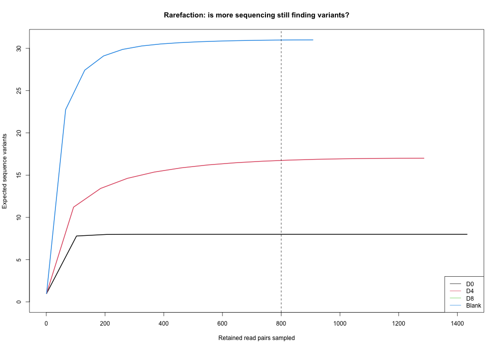
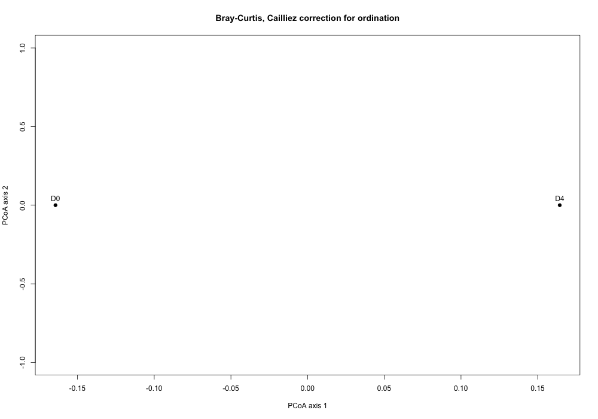
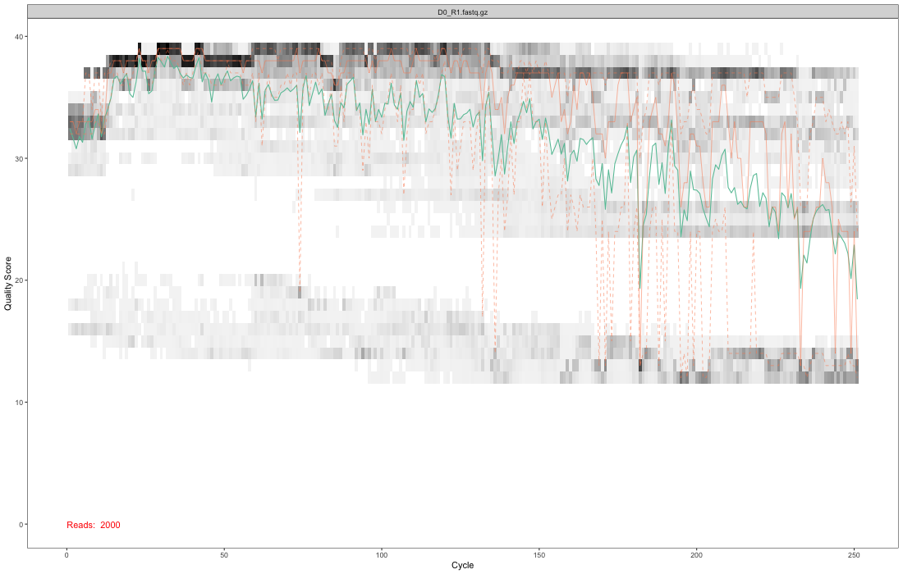
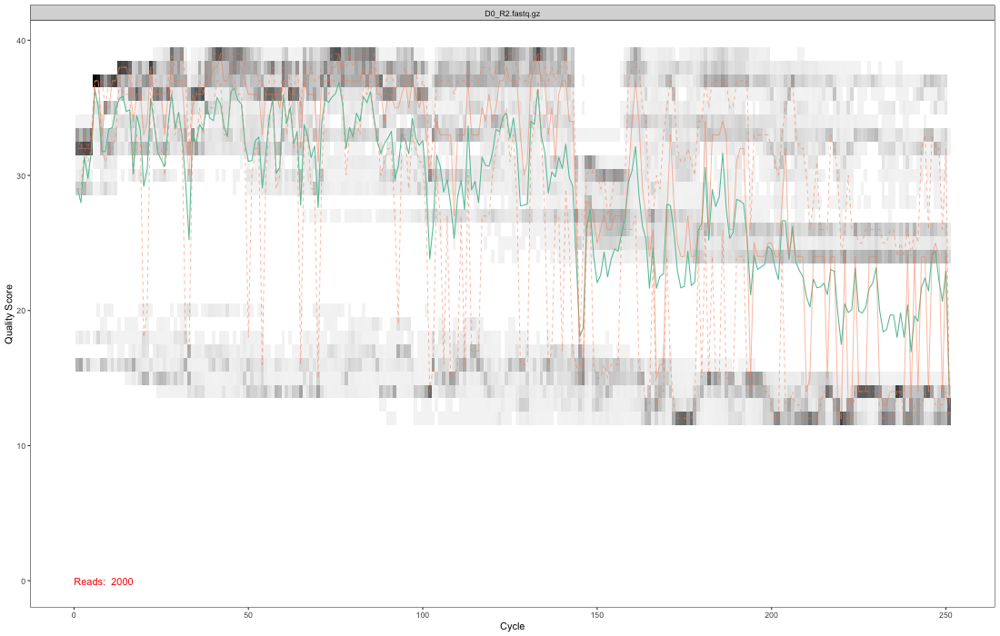
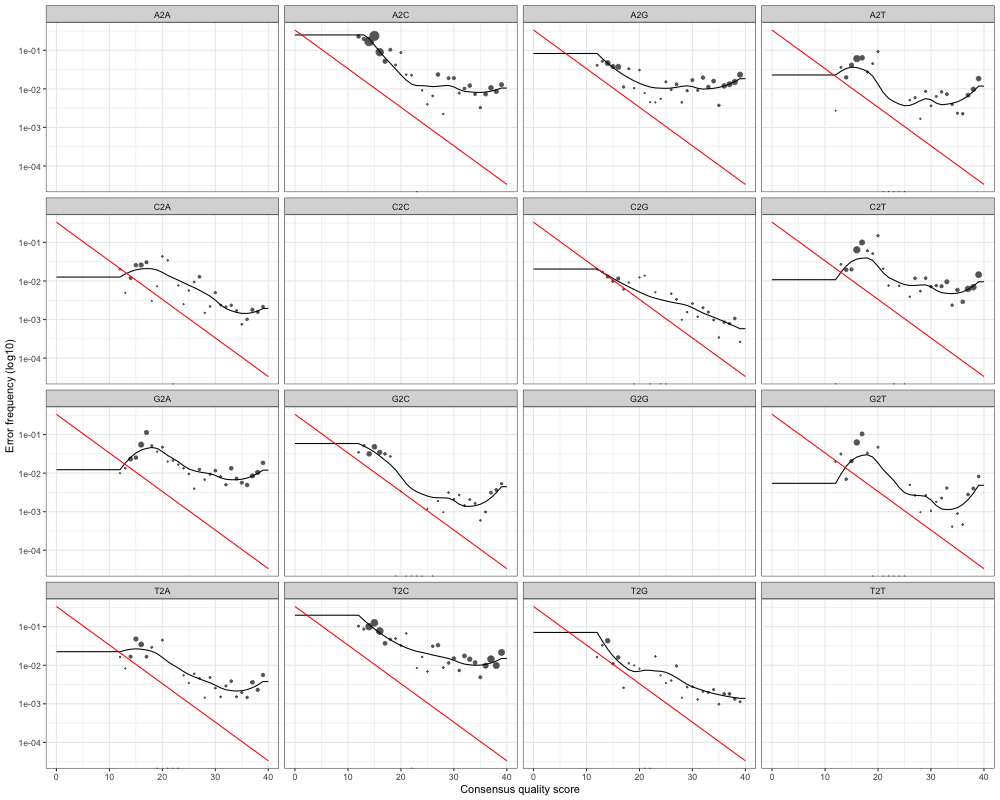

# Tiny public-read CI fixture; restricted taxonomy reference

This report follows public bacterial marker-gene reads from quality checks through sequence inference, organism names and diversity. The samples are a mock-community dilution series, not independent environmental communities. Differences are descriptive; no population or health conclusions follow.

## Run summary

| samples | raw_pairs | nonchimeric_pairs | asvs | eligible_samples | too_shallow_samples | flagged_asvs | depth |
| --- | --- | --- | --- | --- | --- | --- | --- |
| 4 | 6080 | 3627 | 45 | 2 | 1 | 23 | 800 |

ASVs are distinct DNA sequence variants inferred after modelling sequencing errors. Counts are read pairs, not numbers of cells. The depth is a user-selected comparison threshold, not a universal quality standard.

## Read survival

| sample | type | run | raw_pairs | filtered_pairs | denoised_forward | denoised_reverse | merged | nonchimeric |
| --- | --- | --- | --- | --- | --- | --- | --- | --- |
| D0 | sample | SRR7588938 | 2000 | 1558 | 1530 | 1545 | 1437 | 1433 |
| D4 | sample | SRR7588942 | 2000 | 1460 | 1382 | 1418 | 1286 | 1286 |
| D8 | sample | SRR7588945 | 80 | 72 | 30 | 59 | 0 | 0 |
| Blank | negative | SRR10898399 | 2000 | 1654 | 1407 | 1518 | 908 | 908 |

Raw reads were already separated by sample in the archive. The pipeline trims the first bases and low-quality tails, filters expected errors, learns separate forward/reverse error models with DADA2, infers variants, merges overlapping pairs and removes consensus chimeras (artificial mixed sequences).

## Which samples can be compared?

| sample | retained | eligible | status | tail_gain_fraction | rarefaction_warning |
| --- | --- | --- | --- | --- | --- |
| D0 | 1433 | TRUE | ELIGIBLE at requested depth | 0 | small final gain; not proof of complete coverage |
| D4 | 1286 | TRUE | ELIGIBLE at requested depth | 0.000704153989382786 | small final gain; not proof of complete coverage |
| D8 | 0 | FALSE | TOO SHALLOW: excluded from comparison | NA | NO RETAINED READS |
| Blank | 908 | FALSE | CONTROL: excluded from diversity | 0.000323861135770027 | small final gain; not proof of complete coverage |

Controls are always excluded from diversity. Samples below the requested depth are explicitly excluded. The last-column warning checks the expected gain in variants over the final tenth of sequencing. A small gain does not guarantee complete coverage.

## Rarefaction

Rarefaction asks how many variants I would expect to see at a smaller read count. The dashed line marks the requested comparison depth.

## Diversity within each eligible sample

| sample | depth | observed_asvs | shannon | simpson |
| --- | --- | --- | --- | --- |
| D0 | 800 | 8 | 1.80324069190179 | 0.81218125 |
| D4 | 800 | 16 | 1.93969824582696 | 0.80574375 |

Each eligible sample is randomly subsampled without replacement to the same depth with a fixed seed. Observed ASVs counts variants; Shannon diversity reflects richness and evenness; Simpson diversity is one minus the probability of drawing the same variant twice (using relative abundances). One subsample is a reproducible illustration and has sampling uncertainty.

## Diversity between eligible samples

| sample | D0 | D4 |
| --- | --- | --- |
| D0 | 0 | 0.32875 |
| D4 | 0.32875 | 0 |

Bray-Curtis distance runs from identical composition (zero) to no shared variants (one). The plot is a principal-coordinate view of those distances with a Cailliez correction if needed. There are no replicate groups and no significance tests.

## Negative-control check

screened: heuristic only, no automatic removal

The extraction blank is a real archived negative control. The screen flags a variant when its mean relative abundance in nonempty blanks is at least one percent and at least five times its mean in nonempty biological samples. This is a review heuristic, not a validated contaminant classifier. With one blank, prevalence evidence is weak. Carryover, extraction contaminants and true shared organisms can look alike. Nothing is automatically deleted; diversity uses all non-chimeric variants. Empty or missing controls are reported as unavailable.

| asv | blank_mean | sample_mean | blank_prevalence | sample_prevalence | flag |
| --- | --- | --- | --- | --- | --- |
| ASV0006 | 0.0330396475770925 | 0 | 1 | 0 | TRUE |
| ASV0010 | 0.172907488986784 | 0 | 1 | 0 | TRUE |
| ASV0011 | 0.066079295154185 | 0 | 1 | 0 | TRUE |
| ASV0012 | 0.0363436123348018 | 0 | 1 | 0 | TRUE |
| ASV0014 | 0.0330396475770925 | 0 | 1 | 0 | TRUE |
| ASV0015 | 0.0176211453744493 | 0 | 1 | 0 | TRUE |
| ASV0016 | 0.0330396475770925 | 0 | 1 | 0 | TRUE |
| ASV0019 | 0.0176211453744493 | 0 | 1 | 0 | TRUE |
| ASV0020 | 0.013215859030837 | 0 | 1 | 0 | TRUE |
| ASV0022 | 0.013215859030837 | 0 | 1 | 0 | TRUE |
| ASV0023 | 0.0825991189427313 | 0.00660964230171073 | 1 | 0.5 | TRUE |
| ASV0024 | 0.0242290748898678 | 0 | 1 | 0 | TRUE |
| ASV0025 | 0.0209251101321586 | 0 | 1 | 0 | TRUE |
| ASV0026 | 0.0308370044052863 | 0 | 1 | 0 | TRUE |
| ASV0027 | 0.0330396475770925 | 0 | 1 | 0 | TRUE |
| ASV0028 | 0.0198237885462555 | 0 | 1 | 0 | TRUE |
| ASV0029 | 0.0209251101321586 | 0 | 1 | 0 | TRUE |
| ASV0030 | 0.0154185022026432 | 0 | 1 | 0 | TRUE |
| ASV0033 | 0.0209251101321586 | 0 | 1 | 0 | TRUE |
| ASV0036 | 0.0473568281938326 | 0.00272161741835148 | 1 | 0.5 | TRUE |
| ASV0039 | 0.0737885462555066 | 0 | 1 | 0 | TRUE |
| ASV0040 | 0.0781938325991189 | 0 | 1 | 0 | TRUE |
| ASV0043 | 0.0220264317180617 | 0 | 1 | 0 | TRUE |

All variants, including unflagged ones, have control/sample prevalence and abundance recorded in `contamination.tsv`.

## Taxonomy

Organism names are assigned by the DADA2 naive Bayesian classifier using the named reference and a minimum bootstrap support threshold. Uncertain ranks remain NA. These are genus-level annotations, not proof of species identity. Bootstrap support for every rank is saved separately.

| asv | Kingdom | Phylum | Class | Order | Family | Genus |
| --- | --- | --- | --- | --- | --- | --- |
| ASV0001 | Bacteria | Proteobacteria | Gammaproteobacteria | Enterobacterales | Enterobacteriaceae | Salmonella |
| ASV0002 | Bacteria | Proteobacteria | Gammaproteobacteria | Enterobacterales | Enterobacteriaceae | Escherichia/Shigella |
| ASV0003 | Bacteria | Proteobacteria | NA | NA | NA | NA |
| ASV0004 | Bacteria | Proteobacteria | Gammaproteobacteria | Pseudomonadales | Pseudomonadaceae | Pseudomonas |
| ASV0005 | Bacteria | NA | NA | NA | NA | NA |
| ASV0006 | Bacteria | Firmicutes | Clostridia | Clostridiales | NA | NA |
| ASV0007 | Bacteria | Firmicutes | Bacilli | Bacillales | NA | NA |
| ASV0008 | Bacteria | Tenericutes | Mollicutes | Anaeroplasmatales | Anaeroplasmataceae | Anaeroplasma |
| ASV0009 | Bacteria | NA | NA | NA | NA | NA |
| ASV0010 | Bacteria | NA | NA | NA | NA | NA |
| ASV0011 | Bacteria | Firmicutes | Clostridia | Clostridiales | Lachnospiraceae | Herbinix |
| ASV0012 | Bacteria | Firmicutes | Clostridia | Clostridiales | Lachnospiraceae | Herbinix |
| ASV0013 | Bacteria | Firmicutes | Clostridia | Clostridiales | Lachnospiraceae | Herbinix |
| ASV0014 | Bacteria | Firmicutes | Clostridia | Clostridiales | Lachnospiraceae | Herbinix |
| ASV0015 | Bacteria | Firmicutes | Clostridia | Clostridiales | Lachnospiraceae | Herbinix |
| ASV0016 | Bacteria | Firmicutes | Clostridia | Clostridiales | Lachnospiraceae | Herbinix |
| ASV0017 | Bacteria | Firmicutes | Bacilli | Lactobacillales | Lactobacillaceae | Lentilactobacillus |
| ASV0018 | Bacteria | NA | NA | NA | NA | NA |
| ASV0019 | Bacteria | Firmicutes | Clostridia | Clostridiales | NA | NA |
| ASV0020 | Bacteria | NA | NA | NA | NA | NA |
| ASV0021 | Bacteria | Bacteroidetes | NA | NA | NA | NA |
| ASV0022 | Bacteria | NA | NA | NA | NA | NA |
| ASV0023 | Bacteria | NA | NA | NA | NA | NA |
| ASV0024 | Bacteria | Bacteroidetes | NA | NA | NA | NA |
| ASV0025 | Bacteria | Bacteroidetes | NA | NA | NA | NA |
| ASV0026 | Bacteria | NA | NA | NA | NA | NA |
| ASV0027 | Bacteria | NA | NA | NA | NA | NA |
| ASV0028 | Bacteria | NA | NA | NA | NA | NA |
| ASV0029 | Bacteria | NA | NA | NA | NA | NA |
| ASV0030 | Bacteria | Bacteroidetes | NA | NA | NA | NA |
| ASV0031 | Bacteria | Bacteroidetes | NA | NA | NA | NA |
| ASV0032 | Bacteria | NA | NA | NA | NA | NA |
| ASV0033 | Bacteria | Bacteroidetes | NA | NA | NA | NA |
| ASV0034 | Bacteria | Bacteroidetes | NA | NA | NA | NA |
| ASV0035 | Bacteria | Bacteroidetes | NA | NA | NA | NA |
| ASV0036 | Bacteria | Bacteroidetes | NA | NA | NA | NA |
| ASV0037 | Bacteria | Bacteroidetes | Bacteroidia | Bacteroidales | Rikenellaceae | Alistipes |
| ASV0038 | Bacteria | Firmicutes | Bacilli | Lactobacillales | Lactobacillaceae | Liquorilactobacillus |
| ASV0039 | Bacteria | Firmicutes | Clostridia | Clostridiales | Ruminococcaceae | Anaerofilum |
| ASV0040 | Bacteria | Firmicutes | Clostridia | Clostridiales | NA | NA |
| ASV0041 | Bacteria | Firmicutes | Bacilli | Bacillales | Bacillaceae_1 | Bacillus |
| ASV0042 | Bacteria | Firmicutes | Bacilli | Lactobacillales | Enterococcaceae | Enterococcus |
| ASV0043 | Bacteria | Firmicutes | Bacilli | Lactobacillales | Lactobacillaceae | Lactobacillus |
| ASV0044 | Bacteria | Firmicutes | Bacilli | Bacillales | Listeriaceae | Listeria |
| ASV0045 | Bacteria | NA | NA | NA | NA | NA |

## Read quality and fitted errors

These quality-profile images show the first biological sample. `read_quality.tsv` records mean quality and the fraction of bases with Phred score at least 30 for every cycle and mate of every sample. Phred scores describe the chance of a sequencing error. The error plots compare observed error rates with the learned models; inspect them before trusting results on a new dataset.

## Parameters and provenance

| parameter | value |
| --- | --- |
| seed | 104729 |
| depth | 800 |
| trimLeft_F | 15 |
| trimLeft_R | 15 |
| truncLen_F | 230 |
| truncLen_R | 140 |
| maxEE_F | 2.5 |
| maxEE_R | 2.5 |
| taxonomy_min_bootstrap | 80 |
| taxonomy_reference | taxonomy.fa.gz |
| taxonomy_reference_md5 | 9506d041d41781b0ab1dfcf6fdbc29da |
| dada2_version | 1.38.0 |
| control_screen | screened: heuristic only, no automatic removal |

The environment locks, source manifest, sample sheet and commands are in the repository. `sessionInfo.txt` records the executed R package versions. The saved count table, ASV FASTA, taxonomy, bootstrap support, read survival, rarefaction, control screen, rarefied counts and distance matrix allow the report to be checked.

Study: SRP155048. This run retains the first matching read pairs in archive order; it is a technical subset, not the complete study. Positional subsetting can be biased. The original archive files were verified by their published MD5 checksums before subsetting.

| sample | run | pairs | forward_sha256 | reverse_sha256 |
| --- | --- | --- | --- | --- |
| D0 | SRR7588938 | 2000 | 5855ae40d79846bb3ed198c7c45c7357494d2528b289a2fa17ceb0d329555477 | 83fb92e71c90a46861afd020cf46c02dfdb92cccda37e679afc8853784619075 |
| D4 | SRR7588942 | 2000 | 731081bddf28e99dd2aea5498dabee029b27a6081fda03128b6b020f9488c4ed | 63541dd8f9485c518e5e8ed2e4c636635b32a29e2aef377121fb123007f56482 |
| D8 | SRR7588945 | 80 | b8dbe5736f64db8227a13486ace2909732cee02a1787a8047d737511117ff65f | 29fb688952763cefb03ac94159930e2a27a65e37d80f2c19213c310e40b91a8b |
| Blank | SRR10898399 | 2000 | aefdb122487add02740311dde0aa1f7ca1b0812f97e86c791961ad3e6596832f | a8033842c676dcc97e81add6fa52a8ed83e672f0dd274011ecc079e08f08d07d |
